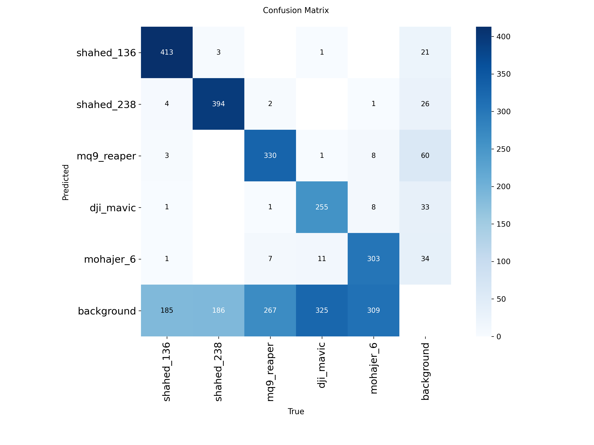
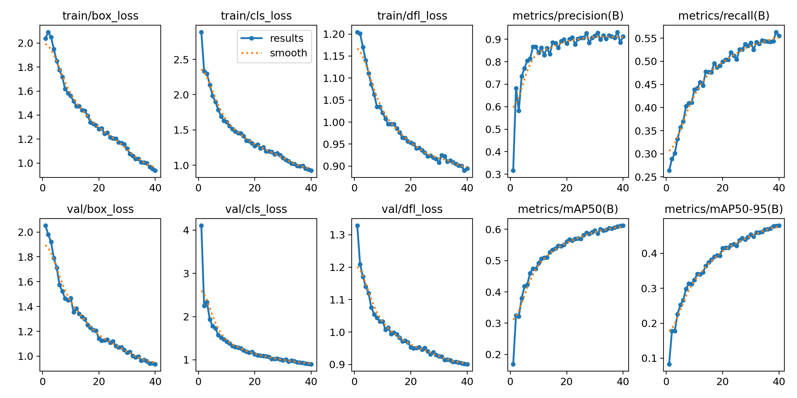

# Drone Detection and Tracking

Object detection and tracking of five drone types using YOLO11, with a Gradio demo for video tracking. This is an educational computer vision project.

**Classes:** Shahed-136, Shahed-238, MQ-9 Reaper, DJI Mavic, Mohajer-6

## Dataset

- Source: Kaggle (drone image dataset)
- Split: 7,000 train / 2,000 validation / 996 test images
- Sample images are in `SampleData/`. The full dataset is not included because of its size.

## Model and Training

- Model: YOLO11l (Ultralytics)
- Epochs: 50
- Image size: 1280
- Training script: `train_drone.py`

## Results

Validation metrics (epoch 40 checkpoint):

| Metric | Value |
|---|---|
| Precision | ~0.92 |
| Recall | ~0.55 |
| mAP50 | ~0.62 |
| mAP50-95 | ~0.42 |

Per-class accuracy (normalized confusion matrix):

| Class | Accuracy |
|---|---|
| Shahed-136 | 0.68 |
| Shahed-238 | 0.68 |
| MQ-9 Reaper | 0.54 |
| Mohajer-6 | 0.48 |
| DJI Mavic | 0.43 |




### Observations

- Precision is high, so detections are usually correct. Recall is lower: many drones are missed and predicted as background.
- Missed detections are most common for DJI Mavic and Mohajer-6, likely because they are small in the frame.
- Loss curves are close to a plateau, but recall was still improving at epoch 40, so longer training (or more epochs than the current 50) could help.

## Tracking Demo

`app.py` is a Gradio app that tracks drones in an uploaded video (BoT-SORT tracker) and counts unique tracked drones.

```bash
pip install -r requirements.txt
MODEL_PATH=path/to/best.pt python app.py
```

Then open http://localhost:7860.

## Model Weights

Trained weights (`best.pt`) are not included in this repository. Available on request.

## Limitations and Future Work

- Improve recall with a longer training run and more small-object examples.
- Evaluate on the held-out test set with per-class mAP.
- Add data augmentation targeted at small and distant drones.

## License

MIT
